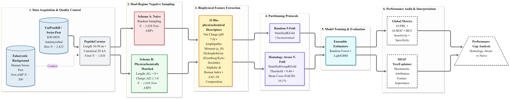
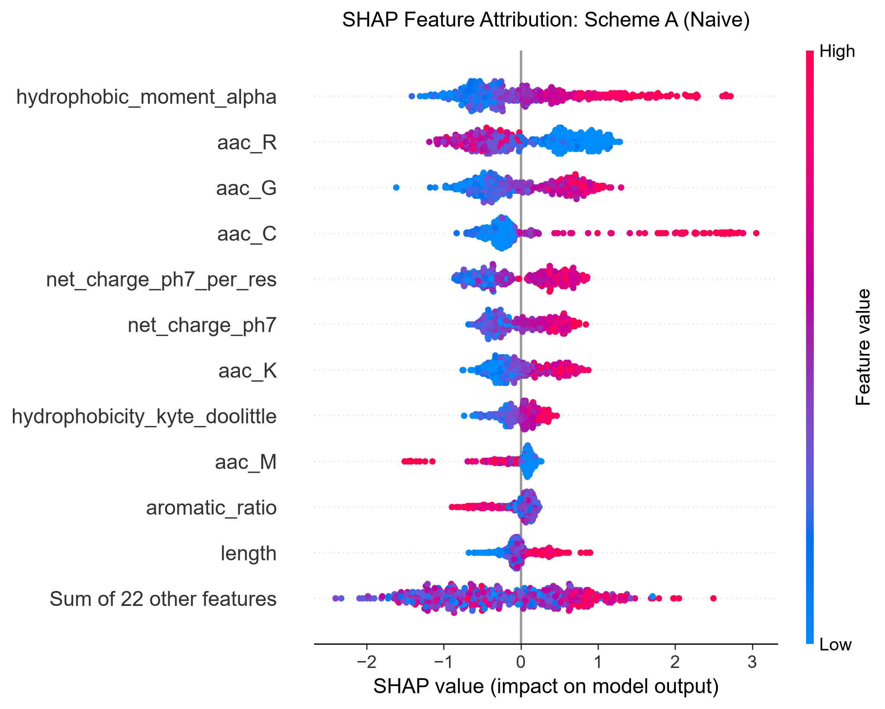
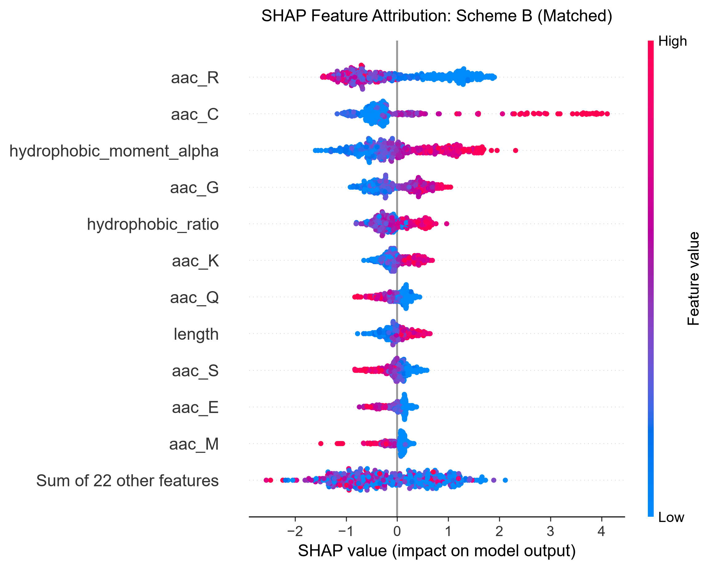

<div align="center">

# 🛡️ AMP-LeakGuard
### Rigorous Benchmarking and De-Biasing of Machine Learning Predictors for Antimicrobial Peptides

[](https://www.python.org/)
[](https://opensource.org/licenses/MIT)
[](https://github.com/psf/black)
[]()
[](https://github.com/MrOnie/AMP-LeakGuard)

</div>

---

## 📌 Overview

**AMP-LeakGuard** is an open-source computational biology benchmarking and auditing framework designed to expose and resolve two critical methodological flaws in machine learning models for bioactive peptides:

1. **Homology-Driven Data Leakage:** Unconstrained random partitioning places homologous sequence variants into both training and validation sets, causing models to memorize family-specific fragments rather than generalizable biophysical rules.
2. **Negative Sampling Bias (Electrostatic Shortcut Learning):** Arbitrary negative sampling from globular eukaryotic proteomes transforms classification into a trivial discrimination of net positive charge, failing to capture true membrane-disruptive biophysics.

AMP-LeakGuard provides end-to-end tooling to curate non-redundant datasets, synthesize paired biophysical negative sets, partition sequences by single-linkage homology clustering (`StratifiedGroupKFold`), audit statistical degradation, and explain decision boundaries via TreeExplainer SHAP.

---

## 🔬 Scientific Workflow

<div align="center">
  
  <p><em>Figure 1: Modular architecture of the AMP-LeakGuard benchmarking and de-biasing framework.</em></p>
</div>

The complete methodology is formally outlined in Mermaid format in [`reports/fig1_pipeline.mmd`](reports/fig1_pipeline.mmd).

---

## 📊 Benchmark Audit Highlights

Using **1,026 manually curated Swiss-Prot mature AMPs** ($10 \le L \le 50$ aa) and **500 reviewed eukaryotic background proteins** ($N = 2,052$ sequences per regime):

### 1. Performance Degradation under Homology-Aware Partitioning

| Negative Regime | Model | Random AUPRC | Homology AUPRC | $\Delta$ AUPRC (Leakage) | Random AUROC | Homology AUROC | Random MCC | Homology MCC | $\Delta$ MCC (Drop) |
| :--- | :--- | :---: | :---: | :---: | :---: | :---: | :---: | :---: | :---: |
| **Scheme A (Naive)** | Random Forest | 0.9536 | 0.9432 | **+0.0104** | 0.9382 | 0.9259 | 0.7718 | 0.7334 | **+0.0384** |
| **Scheme A (Naive)** | LightGBM | 0.9557 | 0.9449 | **+0.0108** | 0.9424 | 0.9287 | 0.7752 | 0.7324 | **+0.0428** |
| **Scheme B (Matched)** | Random Forest | 0.9571 | 0.9448 | **+0.0123** | 0.9462 | 0.9316 | 0.7746 | 0.7314 | **+0.0432** |
| **Scheme B (Matched)** | LightGBM | 0.9521 | 0.9413 | **+0.0108** | 0.9434 | 0.9284 | 0.7701 | 0.7174 | **+0.0527** |

*Verified mean cross-fold global alignment identity across splits was strictly separated down to **16.1%** via `Bio.Align.PairwiseAligner`.*

### 2. Mechanistic Decision Shift Revealed by TreeExplainer SHAP

<div align="center">
  <table>
    <tr>
      <td align="center"><b>Scheme A: Naive Random Sampling</b></td>
      <td align="center"><b>Scheme B: Physicochemically Matched Sampling</b></td>
    </tr>
    <tr>
      <td></td>
      <td></td>
    </tr>
  </table>
  <p><em>Figure 2: SHAP feature attribution beeswarm plots demonstrating how neutralizing net charge forces models to learn genuine bacterial membrane disruption motifs.</em></p>
</div>

* **In Scheme A (Naive Random Negatives):** `net_charge_ph7_per_res` ranks 4th overall (mean $|\text{SHAP}| = 0.5475$), acting as an electrostatic shortcut.
* **In Scheme B (Physicochemically Matched Negatives):** Charge is neutralized, forcing classifiers to prioritize genuine membrane-disruptive biophysics:
  1. **Arginine (`aac_R`, 0.8890):** Bidentate hydrogen bonding of planar guanidinium groups to phospholipid headgroups.
  2. **Cysteine (`aac_C`, 0.7598):** Intramolecular disulfide bridges stabilizing amphipathic defensin folds.
  3. **Amphipathic Hydrophobic Moment (`hydrophobic_moment_alpha`, 0.7453):** Interfacial partitioning into fatty acyl chains.

---

## 📁 Repository Structure

```tree
AMP-LeakGuard/
├── src/                                 # Modular Python package
│   ├── data/
│   │   ├── curation.py                  # Sequence QC, canonical alphabet, length filtering
│   │   ├── negative_sampling.py         # Dual-regime negative generation (A & B)
│   │   └── fetch_databases.py           # Automated UniProtKB REST API connectors
│   ├── features/
│   │   └── physicochemical.py           # 33 vectorized biophysical descriptors (NumPy)
│   ├── splitting/
│   │   └── homology_split.py            # Sequence clustering & StratifiedGroupKFold
│   ├── models/
│   │   └── evaluate.py                  # Cross-validation, metrics, and paired tests
│   ├── visualization/
│   │   ├── plots.py                     # High-res ROC, PRC, and SHAP plots
│   │   └── render_pipeline_figure.py    # Figure 1 visual pipeline renderer
│   └── run_large_scale.py               # End-to-end benchmark execution script
├── data/
│   ├── raw/                             # Downloaded Swiss-Prot dumps (TSV)
│   └── processed/                       # Curated datasets and benchmark tables (CSV, MD)
├── reports/
│   ├── fig1_pipeline.mmd                # Standalone Mermaid diagram source
│   └── figures/                         # High-resolution benchmark figures (300 DPI)
├── config/
│   └── params.yaml                      # Centralized configuration parameters
├── tests/
│   └── test_curation.py                 # Unit test suite (unittest)
├── pyproject.toml                       # Python package configuration
├── LICENSE                              # MIT License
└── README.md                            # Project documentation
```

---

## ⚡ Quick Start & Installation

### 1. Prerequisites
* Python 3.10, 3.11, or 3.12
* [uv](https://github.com/astral-sh/uv) (recommended) or standard `pip`

### 2. Environment Setup

Clone the repository:
```bash
git clone https://github.com/MrOnie/AMP-LeakGuard.git
cd AMP-LeakGuard
```

#### Option A: Using `uv` (Recommended, ~10x faster)
```bash
# Create virtual environment (specify CPython version if you have multiple Pythons installed, e.g. MSYS2/C++)
uv venv .venv --python 3.11

# Activate virtual environment
# On Windows (cmd/PowerShell):
.venv\Scripts\activate
# On Linux/macOS:
source .venv/bin/activate

# Install dependencies in editable mode
# Note: --link-mode copy ensures compatibility across filesystems and cloud-synced folders (OneDrive, etc.)
uv pip install --link-mode copy -e .
```

#### Option B: Using standard Python `venv` and `pip`
```bash
# Create virtual environment with Python's standard library
python -m venv .venv

# Activate virtual environment
# On Windows (cmd/PowerShell):
.venv\Scripts\activate
# On Linux/macOS:
source .venv/bin/activate

# Install dependencies in editable mode using module invocation
python -m pip install -e .
```

---

## 🚀 Execution & Reproducibility Guide

All experiments are 100% deterministic, open-source, and executable locally on standard multi-core CPUs without requiring commercial licenses or GPU clusters.

### Step 1: Run Unit Tests
Verify data validation and feature extraction sanity:
```bash
python -m unittest discover -s tests
```

### Step 2: Download Swiss-Prot Primary Datasets
Fetch curated antimicrobial peptides (KW-0929) and background non-toxin proteins:
```bash
python src/data/fetch_databases.py
```
*Outputs are cached in `data/raw/`.*

### Step 3: Run the Large-Scale Benchmark Audit
Execute curation, dual negative sampling, Stratified Group 5-Fold CV, model training, paired hypothesis testing, and SHAP interpretability:
```bash
python src/run_large_scale.py
```
*Outputs:*
* Results Table: `data/processed/large_scale_benchmark_audit.csv` and `.md`
* Figures generated at 300 DPI in `reports/figures/`

### Step 4: Re-render Figure 1 Workflow
Generate the vector-grade schematic for Figure 1:
```bash
python src/visualization/render_pipeline_figure.py
```

---

## 📋 Best-Practice Community Guidelines

To prevent the recurrence of overoptimistic artifacts in bioactive peptide modeling, we urge the community to adhere to the **AMP-LeakGuard 4-Point Checklist**:

1. **Mandatory Homology Partitioning:** Discontinue random splitting for biological sequence classification. Cluster datasets at identity $\le 40\%$ and assign splits using `StratifiedGroupKFold`.
2. **Controlled Negative Sampling:** Pair negative background slices in sequence length and physiological net charge ($|\Delta Z| \le 1.0$), or utilize experimentally verified inactives ($\text{MIC} > 128\,\mu\text{g/mL}$).
3. **Report AUPRC & MCC:** In heavily imbalanced peptide discovery spaces, prioritize Precision-Recall Area and Matthews Correlation Coefficient over AUROC, accompanied by paired statistical hypothesis tests.
4. **Mechanistic Explainability (XAI):** Always provide SHAP or gradient-attribution analyses to confirm that predictions stem from genuine membrane-lytic features rather than compositional shortcuts.

---

## 📚 Citation & Primary References

If you use **AMP-LeakGuard** in your research, please cite:

```bibtex
@article{martinez2026ampleakguard,
  title={Rigorous Benchmarking and De-Biasing of Machine Learning Predictors for Antimicrobial Peptides: Resolving Homology Leakage and Negative Sampling Artifacts},
  author={Mart{\'\i}nez, Ronie},
  journal={Preprint / Under Review},
  year={2026},
  url={https://github.com/MrOnie/AMP-LeakGuard}
}
```

### Key Foundational Literature
* **Data Leakage in Bio-ML:** Bernett et al. (2024), *Nature Methods*, [DOI: 10.1038/s41592-024-02362-y](https://doi.org/10.1038/s41592-024-02362-y).
* **Negative Sampling Bias in AMPs:** Sidorczuk et al. (2022), *Briefings in Bioinformatics*, [DOI: 10.1093/bib/bbac343](https://doi.org/10.1093/bib/bbac343).
* **Evaluation Standards in Peptide DBs:** Pintor et al. (2026), *Journal of Chemical Information and Modeling*, [DOI: 10.1021/acs.jcim.6c02141](https://doi.org/10.1021/acs.jcim.6c02141).
* **DOME Recommendations:** Walsh et al. (2021), *Nature Methods*, [DOI: 10.1038/s41592-021-01205-4](https://doi.org/10.1038/s41592-021-01205-4).
* **Shortcut Learning in Deep Neural Networks:** Geirhos et al. (2020), *Nature Machine Intelligence*, [DOI: 10.1038/s42256-020-00257-z](https://doi.org/10.1038/s42256-020-00257-z).
* **Peptide Physicochemical Scales:** Eisenberg et al. (1984), *J. Mol. Biol.*, [DOI: 10.1016/0022-2836(84)90509-9](https://doi.org/10.1016/0022-2836(84)90509-9).
* **Explainable AI:** Lundberg & Lee (2017), *NeurIPS*, [arXiv: 1705.07874](https://doi.org/10.48550/arXiv.1705.07874).

---

## 📜 License

This project is licensed under the **MIT License** — see the [LICENSE](LICENSE) file for details.
